# Renforcement musculaire à domicile

## Objectifs et matériel

Compléter trois sorties hebdomadaires de course par deux courtes séances de renforcement, adaptées à un emploi du temps chargé. Priorités : jambes et fessiers, dos, épaules, pectoraux et biceps.

Matériel disponible : **deux haltères de 3 kg** et **une barre de traction de porte**. Les exercices au poids du corps complètent cet équipement. Aucun besoin identifié d'acheter immédiatement des poids plus légers : choisir la charge selon la technique et le confort, mouvement par mouvement.

Le programme est **proposé**, et non un relevé de séances effectuées.

## Organisation et progression

- **Option de référence : 2 séances Full Body de 20–25 minutes par semaine**, réparties aussi régulièrement que possible (par exemple lundi–jeudi ou mardi–vendredi) : généralement **2 puis 3 jours complets sans renforcement** entre les séances. Un intervalle d'environ 48 heures constitue un minimum pratique de récupération des mêmes groupes musculaires, pas une cible d'espacement.
- Échauffement léger de 3 minutes : marche, mouvements des épaules et des hanches.
- Au démarrage : **1 série par exercice**, avec 2 à 4 répétitions possibles en réserve et sans échec musculaire. Se reposer 45–90 secondes selon le besoin.
- Après 2–3 semaines bien tolérées, ajouter une deuxième série aux mouvements prioritaires si la récupération le permet (les séances pourront alors durer 25–35 minutes).
- Les séances peuvent être réalisées **après une sortie de course**, idéalement après un footing facile : si les deux entraînements sont le même jour, **courir d'abord, puis faire le renforcement**, et éviter l'ordre inverse pour préserver la qualité du running. Après une sortie longue ou un fractionné exigeant, réduire le volume de renforcement (surtout des jambes) ou reporter si la fatigue est importante.
- Éviter une séance de renforcement exigeante des jambes la veille d'une sortie rapide, d'un test ou d'une compétition.
- **Autre organisation possible : 3 séances plus courtes de 10–15 minutes par semaine**, environ un jour sur deux (par exemple lundi–mercredi–vendredi), en alternant A/B/A puis B/A/B et **en réduisant les exercices ou séries par séance**, sans augmenter brutalement le volume hebdomadaire total. Choisir cette option si elle est plus facile à maintenir avec les 3 sorties de running ; conserver au moins une journée sans travail exigeant des mêmes muscles entre deux séances.
- Si l'emploi du temps est chargé, une **séance express de 8–10 minutes** est préférable à une séance trop ambitieuse.

Les **séances A et B sont deux variantes Full Body**, à alterner selon le planning. Les trois séances courtes éventuelles ne s'ajoutent pas à A et B : elles les remplacent avec moins d'exercices par séance.

## Séance A

| Exercice | Départ conseillé | Muscles et points techniques |
|---|---|---|
| Squat au poids du corps | 10–12 répétitions | Quadriceps et fessiers ; amplitude confortable. Ensuite, possibilité de tenir un haltère de 3 kg contre la poitrine |
| Rowing unilatéral à 3 kg | 10–12 par côté | Dos et biceps ; appui de la main libre, dos neutre, tirer le coude vers la hanche |
| Pompes | 6–10 | Pectoraux, triceps et épaules ; commencer à genoux ou inclinées, selon la variante permettant un mouvement propre (gainage, coudes à environ 30–45° du buste). Passer progressivement aux pompes classiques lorsque la force et la technique le permettent |
| Pont fessier | 12–15 | Fessiers ; monter le bassin sans cambrer excessivement |
| Curl biceps à 3 kg | 8–12 | Coudes proches du corps ; éviter l'élan |
| Élévations latérales à 2 × 3 kg | 8–10 (si contrôlé) | Deltoïdes moyens ; coudes un peu fléchis, pas de balancement, bras au plus à hauteur des épaules |

### Exécution des exercices — séance A

Les dessins sont des **schémas de mouvement**, non des mesures exactes des angles articulaires. Les consignes et le contrôle du geste priment sur les dessins.

### Squat au poids du corps

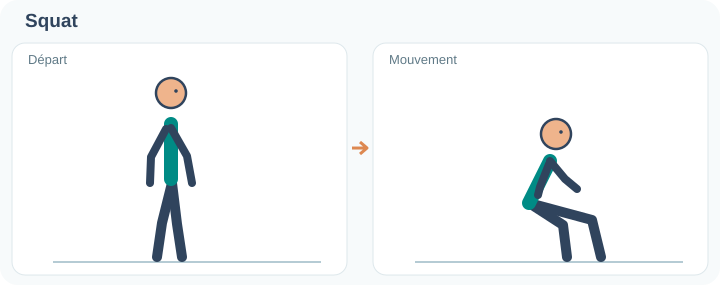

Pieds écartés environ à la largeur des épaules. Reculer les hanches et plier les genoux comme pour s’asseoir, en gardant les talons au sol et les genoux dans l’axe des pieds. Remonter en poussant dans les pieds ; ajouter un haltère contre la poitrine seulement après avoir maîtrisé le mouvement.

### Rowing unilatéral

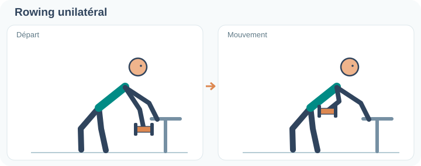

Avec une main posée sur un support stable, incliner le buste en conservant le dos neutre. Laisser l’haltère descendre sous l’épaule, puis tirer le coude vers la hanche sans tourner le buste. Redescendre lentement ; répéter de l’autre côté.

### Pompes

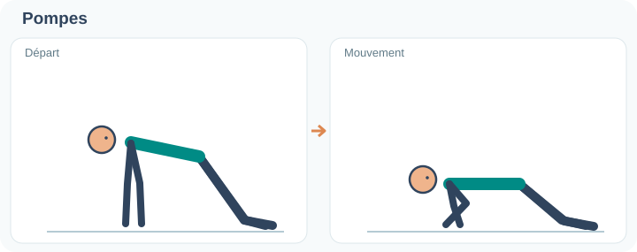

Mains légèrement plus écartées que les épaules, corps gainé. Commencer **à genoux** (alignement tête–bassin–genoux) ou **en inclinaison** sur un support stable. Descendre en contrôlant les coudes, environ à 30–45° du buste, puis repousser. Passer aux pompes classiques lorsque la variante facile est bien maîtrisée.

### Pont fessier

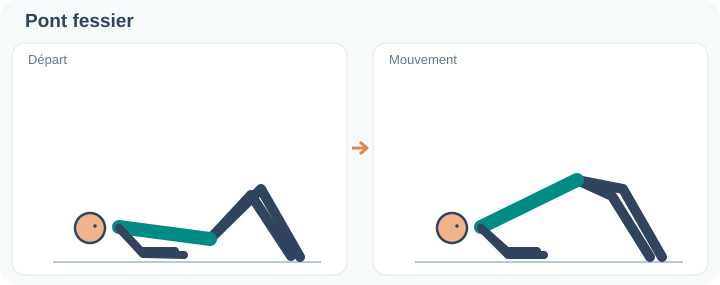

Allongé sur le dos, genoux fléchis et pieds à plat. Contracter les fessiers pour lever le bassin jusqu’à aligner approximativement épaules, hanches et genoux, sans creuser les lombaires. Marquer une courte pause puis redescendre sous contrôle.

### Curl biceps

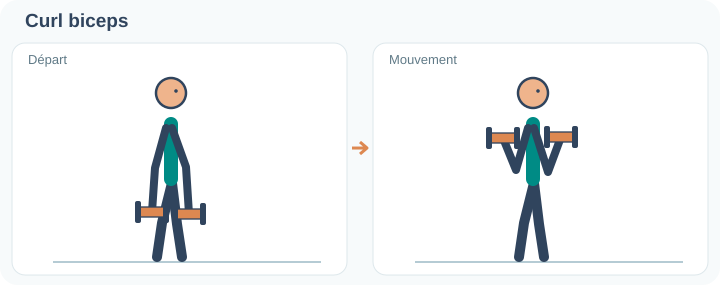

Debout, coudes proches du buste et poignets neutres, plier les coudes pour monter les haltères sans prendre d’élan. Garder les épaules immobiles, puis redescendre lentement.

### Élévations latérales

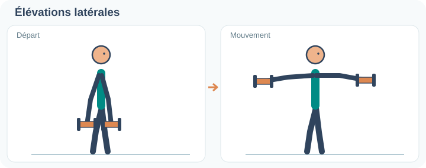

Debout, bras le long du corps, coudes légèrement fléchis. Lever les haltères sur les côtés jusqu’à hauteur d’épaule au maximum, sans hausser les épaules ni balancer le tronc. Redescendre lentement ; diminuer la charge si la technique se dégrade.

## Séance B

| Exercice | Départ conseillé | Muscles et points techniques |
|---|---|---|
| Soulevé de terre roumain à 2 × 3 kg | 10–12 | Ischio-jambiers et fessiers ; hanches en arrière, colonne neutre |
| Squat sur chaise | 10–12 | Quadriceps et fessiers ; choisir une amplitude confortable pour les genoux |
| Rowing unilatéral à 3 kg | 10–12 par côté | Dos et biceps ; même technique qu'en séance A |
| Développé couché au sol à 2 × 3 kg | 12–15 | Pectoraux et triceps ; coudes à environ 30–45° du buste, descente lente et contrôlée |
| Développé épaules unilatéral | 8–10 par côté, avec 3 kg si confortable | Épaules et triceps ; pas de cambrure du dos |
| Bird-dog | 6 par côté | Contrôle du tronc et des hanches |

### Exécution des exercices — séance B

### Soulevé de terre roumain

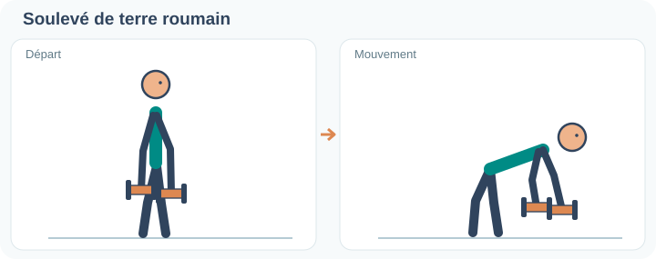

Debout, haltères près des cuisses, genoux légèrement fléchis. Pousser les hanches vers l’arrière en penchant le buste, dos neutre et haltères près des jambes. S’arrêter lorsque l’étirement des ischio-jambiers devient net **sans arrondir le dos**, puis revenir debout en avançant les hanches.

### Squat sur chaise

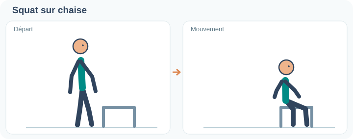

Se placer devant une chaise stable, pieds écartés à peu près à la largeur des épaules. Reculer les hanches et descendre jusqu’à effleurer l’assise, sans se laisser tomber. Se relever en poussant sur les pieds ; adapter la hauteur de la chaise à la tolérance des genoux.

### Rowing unilatéral

Même exercice qu’en séance A : main libre sur un appui stable, buste incliné et dos neutre, tirer l’haltère vers la hanche sans faire pivoter le tronc.

### Développé couché au sol

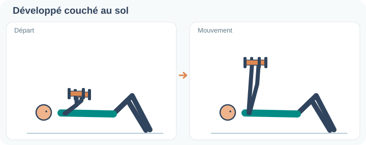

Allongé sur le dos, genoux fléchis, un haltère dans chaque main. Partir avec les bras supérieurs proches du sol et les coudes à environ 30–45° du buste. Pousser au-dessus de la poitrine, puis redescendre lentement sans rebondir sur le sol.

### Développé épaules unilatéral

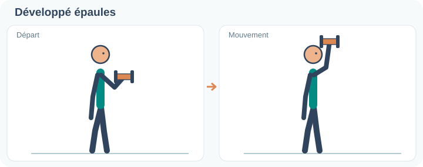

Assis ou debout, tenir un haltère près de l’épaule, paume orientée confortablement. Pousser au-dessus de la tête sans cambrer les lombaires ni hausser fortement l’épaule. Redescendre sous contrôle ; changer de bras.

### Bird-dog

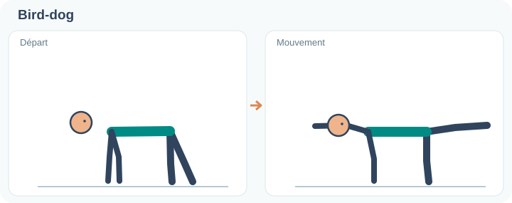

Se mettre **à quatre pattes**, mains sous les épaules et genoux sous les hanches. Tendre **simultanément le bras droit et la jambe gauche**, à hauteur du tronc, sans creuser le dos ni tourner le bassin. Revenir lentement à quatre pattes, puis inverser bras et jambe. Faire 6 répétitions de chaque côté, lentement.

**Variante pectoraux :** développé serré au sol (*squeeze press*), en pressant légèrement les deux haltères l'un contre l'autre, 10–12 répétitions. À alterner avec le développé classique, sans multiplier les exercices dès le départ.

### Développé serré au sol (variante)

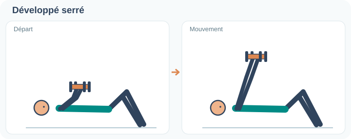

Allongé sur le dos, coudes fléchis, rapprocher les deux haltères au-dessus du sternum et les presser doucement l’un contre l’autre. Les pousser verticalement en maintenant le contact, puis revenir lentement. C’est une **alternative** au développé couché au sol, pas un exercice supplémentaire obligatoire.

## Squats et charge des jambes

Les squats sollicitent principalement les **quadriceps**, les **grands fessiers** et les **adducteurs**. Les ischio-jambiers sont mieux ciblés par les mouvements de charnière de hanche comme le soulevé de terre roumain ; le pont fessier complète le travail des fessiers.

Commencer les squats sans charge avant d'utiliser un ou deux haltères. En cas de gêne autour de la rotule droite, réduire l'amplitude ou la charge et contrôler la réaction du genou le lendemain. Si la gêne devient persistante ou s'aggrave, demander un avis médical ou kinésithérapique.

## Haltères et épaules

- **Élévations latérales :** les haltères de 3 kg peuvent être utilisés si les répétitions sont propres et sans douleur. Commencer par 8–10 répétitions, sans hausser les épaules ni donner d'élan.
- **Développé épaules :** tester la charge un bras à la fois, en gardant une posture stable.
- Une charge plus légère n'a d'intérêt que si 3 kg empêchent un mouvement contrôlé ; une bouteille d'eau permet d'essayer avant d'acheter.
- **Pompes :** choisir au départ une variante à genoux ou inclinée, avec contrôle et sans douleur. À genoux, garder l'alignement tête–bassin–genoux ; inclinées, utiliser un support fixe et stable. Lorsque 10–12 répétitions sont maîtrisées avec une marge, essayer une variante plus difficile, jusqu'aux pompes classiques. Compléter par le développé couché au sol avec haltères.

## Barre de traction : détente et progression

- **Sécurité d'abord :** vérifier la notice, le système de fixation, l'encadrement et la charge admissible. Éviter tout balancement.
- **Pause détente :** une ou deux suspensions de 10–20 secondes avec **appui partiel des pieds** si nécessaire. Ne pas chercher un étirement maximal ni laisser les épaules partir brutalement vers le haut.
- **Activation scapulaire :** 4–6 petites répétitions, coudes tendus, en abaissant légèrement les omoplates ; pieds en appui si besoin.
- **Tractions assistées :** progression ultérieure, quand la suspension est confortable et la fixation vérifiée ; commencer par 2–4 répétitions avec l'aide des jambes.
- Arrêter en cas de douleur à l'épaule, de picotements ou de sensations inhabituelles. Les suspensions sont une pause de détente, **pas un traitement médical pour le dos**.

## Bureau assis-debout et pauses actives

- Bureau **mécanique**, sans moteur ni positions mémorisées ; le réglage peut demander un peu de temps.
- L'utilisation **debout** fait partie des possibilités actuelles. Pour entretenir l'habitude, associer un passage debout à un déclencheur simple (par exemple après le déjeuner), sans imposer de multiples réglages.
- Privilégier l'alternance des postures et de courtes marches : rester immobile debout longtemps n'est pas un objectif en soi.
- Si le réglage devient peu pratique lors d'une journée chargée, conserver les petites pauses de mouvement plutôt que de renoncer à bouger.

## Version express

Une série de squats confortables, une série de rowing par bras, une série de **pompes** (à genoux ou inclinées au départ) **ou** de développé couché au sol, puis un pont fessier ou un curl biceps : **8–10 minutes**.

## Suivi

Ajuster les charges et les répétitions selon la qualité du geste, la fatigue et la tolérance des articulations. Ne consigner dans le dépôt que les séances sportives réellement effectuées lorsqu'elles présentent un intérêt pour le suivi, et non les essais ponctuels ou détails de conversation.
